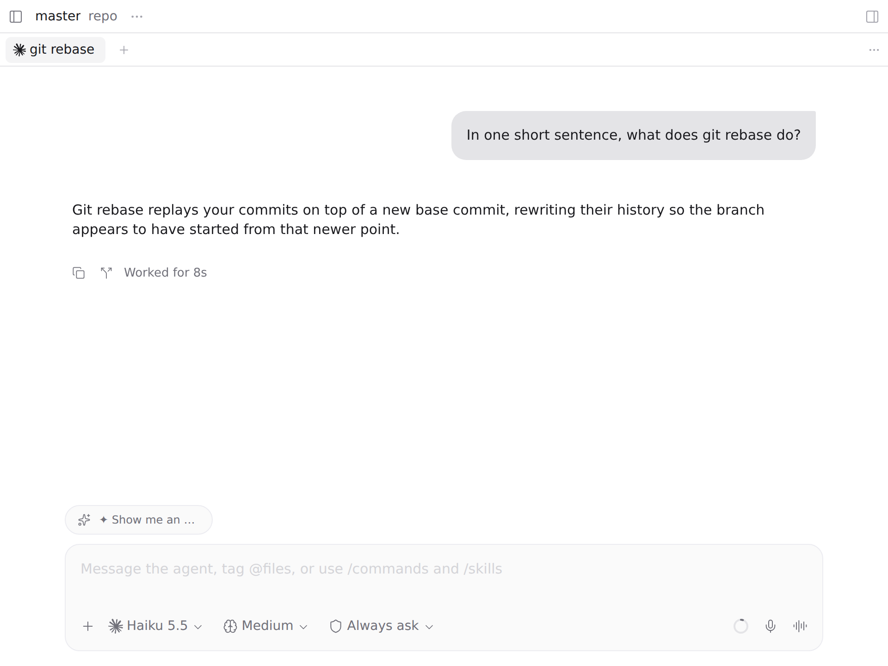
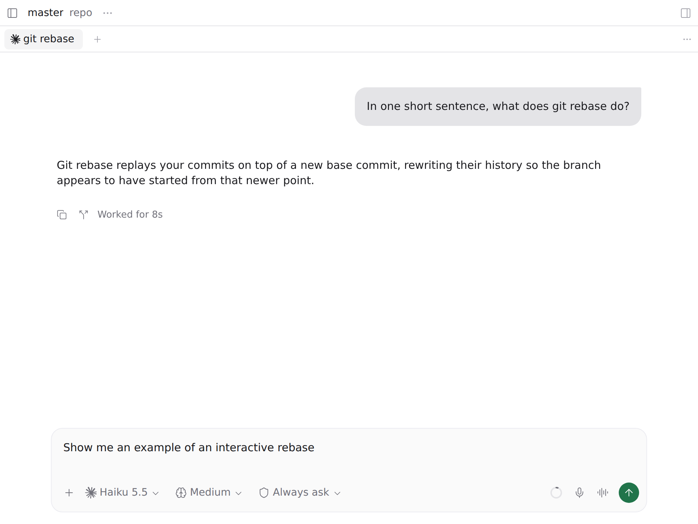

# Suggested next message

After an agent finishes a turn and the session stays quiet for a minute, a small model reads the conversation and proposes the
message you would most likely send next. It shows up as a pill above the composer; one tap puts the text in that agent's
prompt, ready to edit and send with Enter.

*Both screenshots come from a test Paseo: the exchange is real, the suggestion in them is a fixed example text, not a model's answer.*

## How it works

- When a turn ends completed and nothing happens for 60 s (the settings screen offers 30 s, 1, 2 or 5 min), one call with the
  conversation goes to the model. Finished work, optional offers and decisions that are yours to make get no suggestion, so
  no pill appears. The answer is capped at 256 tokens (the model may spend part of it thinking before the line).
- The pill is per agent. Nothing enters the prompt on its own — a finished generation waits on its pill until you press it. Tapping
  the pill **appends** the text to that agent's prompt, a line below what you already typed, and
  never replaces it; **Ctrl+Z** takes it back. It writes only into the composer of the window the pill sits in: when that window is
  not the one in front it writes nothing rather than into the one you are looking at. Where it cannot reach the prompt (phones,
  narrow layouts, or a prompt it cannot tell apart from another pane's), the pill opens a small editable card instead, with a send
  button.
- A new turn drops the pending suggestion. Nothing is sent for you unless you start the agent's **Autopilot**.
- **Autopilot** (a start form in the ✦'s popover and in the mobile card, per agent; since 14-11-2026): «Empezar» asks the
  company supervisor to pair this session with an auditor session B — another model (Opus 5.5 by default, from your provider's
  model list) that plans, audits against the criteria and writes A's next prompt; B never implements. The objective is the plan
  the session is anchored to or a prompt you write. The plugin only starts and stops the pair and shows its state: gold and
  spinning while it works or waits, bright red and pulsing when a person is needed (fixed red when the auditor stopped
  answering), green once delivered; the popover carries the reason, the steps, the last send, the auditor and «Parar». Its
  state comes from the supervisor's registry (`~/.company/jira-trigger/autopilot-pares.json`): no file means no pair. It is
  not the «suggest automatically» setting, which only proposes.
- **Goal** (a button in each workspace's header; since 15-11-2026): write a goal, pick the session's and the auditor's models,
  and «Empezar» creates a new session in that workspace already paired with its auditor, which writes its first message.
- Settings (plugin settings screen): on/off and the quiet window (the autopilot's caps died with the plugin's loop — the
  supervisor decides the steps).

## Requirements

This plugin was built for one setup and is published as it runs there. Read this part first:

- **Claude agents only.** It finds the agent's Claude Code transcript; an agent of another provider gets no suggestion.
- **An Anthropic-compatible endpoint (LiteLLM) that serves the session's own model.** The plugin takes its url and key from
  `~/.config/claude-local/env` (`ANTHROPIC_BASE_URL`, `ANTHROPIC_AUTH_TOKEN`) and calls `POST /v1/messages` with the model the
  session is running (the `message.model` of the last assistant message in the transcript). There is no fixed or fallback model:
  a session with no real model yet gets no call. Without the endpoint no pill ever appears (`paseo plugin logs paseo-sugiere`
  says "the model door (LiteLLM) did not answer").
- **Cost.** Each suggestion sends the conversation (up to ~100k tokens) to the session's model, without sharing the session's cache.
- **Spanish by default.** The instruction asks for the suggestion in Spanish and the settings screen is in Spanish. The
  instruction lives in the `sugiere` service only; the plugin sends none.
- Paseo `>=0.15.4`.

## What it reads, sends and writes

- **Reads** the agent's transcript (`<CLAUDE_CONFIG_DIR or ~/.claude>/projects/*/<session>.jsonl`, located through the Claude
  providers in `$PASEO_HOME/config.json`), and, if present, `~/.local/state/paseo-plan/anchor-<agentId>.json`, the ticket's plan anchor
  written by paseo-plan (used only with its `guard` on).
- **Sends** the text of the conversation (your messages and the assistant's replies since the last compaction; past about
  400,000 characters the oldest are left out), the instruction and one closing question to that endpoint and nowhere else,
  with the key from `~/.config/claude-local/env`. Tool calls and thinking are removed before the call, and so are tool results unless the plan anchor is on (`guard`): then the anchor and the tool results since your last message (trimmed) go along. From
  `$PASEO_HOME/config.json` it uses only each Claude provider's `CLAUDE_CONFIG_DIR`; it reads no account token (only the LiteLLM url and key from the env file above).
- **Writes**, in the Paseo client on web and desktop, into the composer's text box: it types the text into it (`execCommand`
  `insertText`, with an `input` event as the fallback), so Paseo's own handlers store the draft as if you had typed it. It
  looks for the box of the pane the pill sits in and does nothing if that pane holds more than one, if its own box is not displayed
  (the window is behind), or if the pill itself is off screen.

## Known limits

The text reaches the prompt by writing into Paseo's own page, because the plugin SDK has no API for the composer's draft. If a
Paseo update changes that page, the plugin falls back to the small card. The code that does it is one module
(`client/composer-bridge.ts`), marked as a shortcut, and it is deleted the day the SDK exposes the draft.
