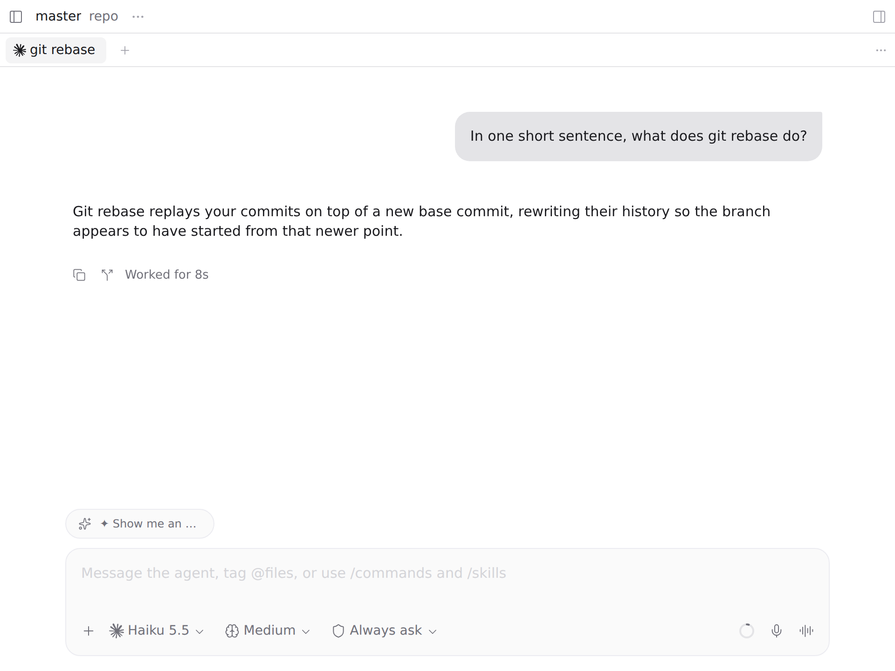
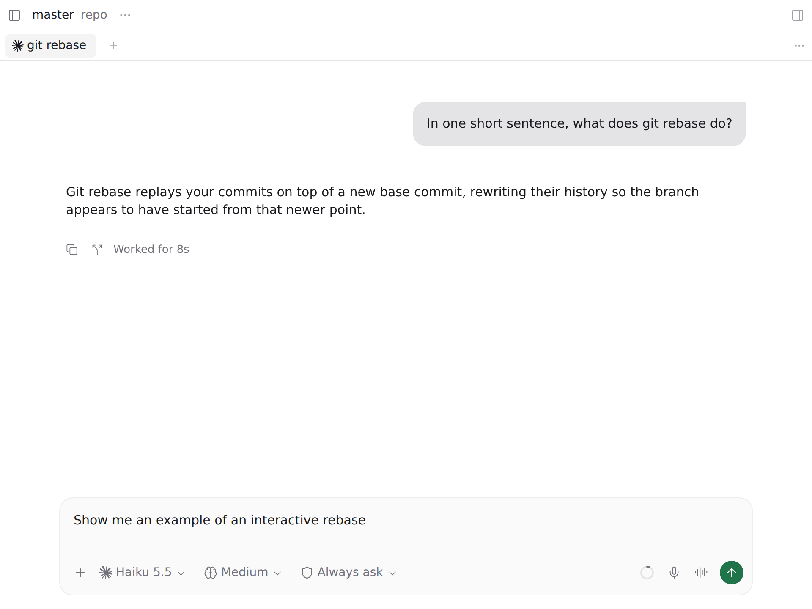

# Suggested next message

After an agent finishes a turn and the session stays quiet for a minute, a small model reads the conversation and proposes the
message you would most likely send next. It shows up as a pill above the composer; one tap puts the text in that agent's
prompt, ready to edit and send with Enter.

*Both screenshots come from a test Paseo: the exchange is real, the suggestion in them is a fixed example text, not a model's answer.*

## How it works

- When a turn ends completed and nothing happens for 60 s (the settings screen offers 30 s, 1, 2 or 5 min), one call with the
  conversation goes to the model. Finished work, optional offers and decisions that are yours to make get no suggestion, so
  no pill appears. The answer is capped at 48 tokens.
- The pill is per agent. Tapping it **appends** the text to that agent's prompt, a line below what you already typed, and
  never replaces it; **Ctrl+Z** takes it back. Where it cannot reach the prompt (phones, narrow layouts, or a prompt it cannot
  tell apart from another pane's), the pill opens a small editable card instead, with a send button.
- A new turn drops the pending suggestion. Nothing is ever sent for you: sending is always your tap or Enter.
- Settings (plugin settings screen): on/off, and the quiet window.

## Requirements

This plugin was built for one setup and is published as it runs there. Read this part first:

- **Claude agents only.** It finds the agent's Claude Code transcript; an agent of another provider gets no suggestion.
- **An Anthropic-compatible endpoint (LiteLLM) that serves the session's own model.** The plugin takes its url and key from
  `~/.config/claude-local/env` (`ANTHROPIC_BASE_URL`, `ANTHROPIC_AUTH_TOKEN`) and calls `POST /v1/messages` with the model the
  session is running (the `message.model` of the last assistant message in the transcript). There is no fixed or fallback model:
  a session with no real model yet gets no call. Without the endpoint no pill ever appears (`paseo plugin logs paseo-sugiere`
  says "the model door (LiteLLM) did not answer").
- **Cost.** Each suggestion sends the conversation (up to ~100k tokens) to the session's model, without sharing the session's cache.
- **Spanish by default.** The built-in instruction asks for the suggestion in Spanish and the settings screen is in Spanish. For
  another language or style, put your own instruction in `~/.local/state/paseo-sugiere/prompt.txt`: it is read on every
  suggestion, and a missing or empty file means the built-in one.
- Paseo `>=0.11.2 <0.12.0`.

## What it reads, sends and writes

- **Reads** the agent's transcript (`<CLAUDE_CONFIG_DIR or ~/.claude>/projects/*/<session>.jsonl`, located through the Claude
  providers in `$PASEO_HOME/config.json`), and, optionally, `~/.local/state/paseo-sugiere/prompt.txt`, a file that replaces
  the built-in instruction.
- **Sends** the text of the conversation (your messages and the assistant's replies since the last compaction; past about
  400,000 characters the oldest are left out), the instruction and one closing question to that endpoint and nowhere else,
  with the key from `~/.config/claude-local/env`. Tool calls, tool results and thinking are removed before the call. From
  `$PASEO_HOME/config.json` it uses only each Claude provider's `CLAUDE_CONFIG_DIR`; it reads no account token (only the LiteLLM url and key from the env file above).
- **Writes**, in the Paseo client on web and desktop, into the composer's text box: it types the text into it (`execCommand`
  `insertText`, with an `input` event as the fallback), so Paseo's own handlers store the draft as if you had typed it. It
  looks for the box of the pane the pill sits in and does nothing if it finds none or more than one.
- **Self-update, on the author's machine only.** `index.server.ts` spawns `scripts/autodeploy.sh` at start and every five
  minutes, but only if `~/.local/share/paseo-sugiere/paseo-plugin/current/scripts/autodeploy.sh` exists. `scripts/deploy.sh`
  creates that folder, and neither the registry nor Paseo's installer ever runs it, so on an installed copy the check fails
  (one warning line in the plugin log) and nothing else happens. Where it does exist, the script runs `git ls-remote` against
  `https://github.com/pocharlies-org/paseo-sugiere` and, when `main` has a commit that is not deployed yet, shallow-clones it
  and runs that clone's `scripts/deploy.sh`: it copies the files listed in `package.json` into
  `~/.local/share/paseo-sugiere/paseo-plugin/<version>-<sha>/`, points `current` at that folder and has the Paseo CLI reload the
  plugin from there. It logs to `~/.local/state/paseo-sugiere/autodeploy.log` and sends no data, only the git request.

## Known limits

The text reaches the prompt by writing into Paseo's own page, because the plugin SDK has no API for the composer's draft. If a
Paseo update changes that page, the plugin falls back to the small card. The code that does it is one module
(`client/composer-bridge.ts`), marked as a shortcut, and it is deleted the day the SDK exposes the draft.
